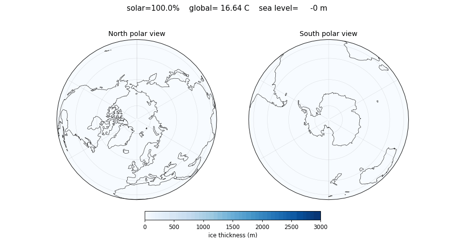
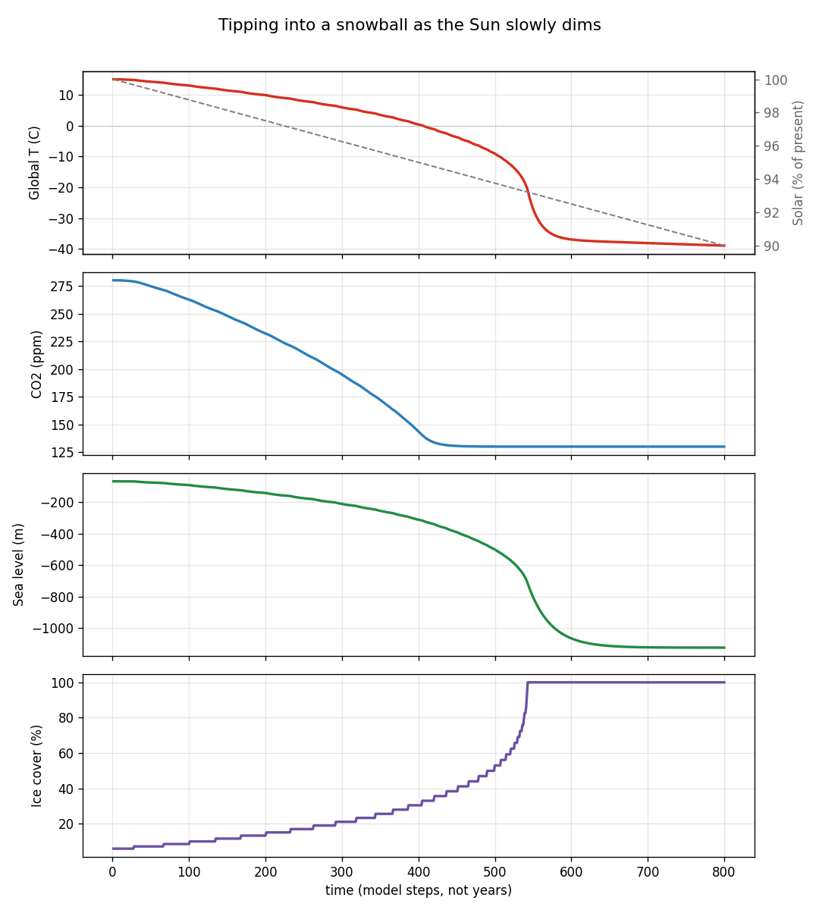
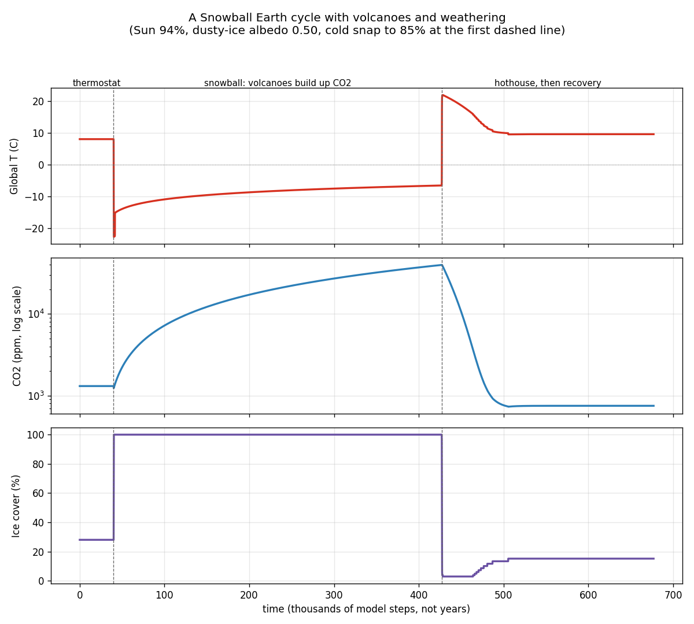

# Ice Age Simulator

[](https://github.com/eduardobussien/ice-age-simulator/actions/workflows/ci.yml)
[](LICENSE)



**What happens to Earth if the Sun gets a little dimmer?** Dimming it by just a
few percent can freeze the entire planet, and once it is frozen, it is
extremely hard to thaw.

This is a Snowball Earth simulator built on the classic Budyko-Sellers
energy-balance climate model (1969), with ice-albedo and CO2 feedbacks and an
optional volcanic carbon cycle. The physics runs in a **C++17 core**, exposed
to Python through **pybind11** as zero-copy NumPy arrays, with **Matplotlib**
and **Cartopy** for plots, animations and a live slider.

> **What kind of model this is:** a **1-D latitude model**. Climate varies only
> from pole to equator; there are **no continents**, no seasons, and no
> longitude differences. The maps are drawn on a latitude x longitude grid for
> display, but every longitude in a row is identical, and coastlines are drawn
> for orientation only. See [Honest limitations](#honest-limitations).

## Quick start

You need Python 3.9+, CMake 3.18+ and a C++17 compiler (GCC, Clang, or MSVC).
The C++ extension builds automatically during install.

```bash
git clone https://github.com/eduardobussien/ice-age-simulator.git
cd ice-age-simulator
pip install -e .
python -m python_sim.interactive
```

Drag the slider to dim or brighten the Sun and watch the ice respond. Push it
down toward 94% and the ice runs away into a snowball. Then try to bring it
back: you can't, even at the slider's maximum of 115% (see
[why](#freezing-is-easy-thawing-is-hard)). Press **Reset** to return to today's
climate.

Every other experiment is a one-line command too; see [Run](#run). For
compiler details (including MinGW on Windows) see [Install](#install).

---

## Earth has actually done this

- Between roughly **720 and 635 million years ago**, ice spread all the way to
  the equator, at least twice. Geologists call it **Snowball Earth**, a name
  coined by Joseph Kirschvink in 1992.
- Back in **1969**, Mikhail Budyko and William Sellers independently built
  simple climate models that predicted this kind of runaway freeze, long before
  the geological evidence for it was widely accepted.
- The Sun was dimmer back then: standard models of how the Sun brightens over
  time (Gough 1981) put it at about **94% of today's brightness**. That is
  right where this model tips over, although the leading explanations point
  to falling CO2 as the main trigger, with the fainter Sun leaving Earth
  closer to the edge.
- The real snowball ended because volcanoes kept pumping CO2 into the air.
  With the planet frozen, almost nothing removed it, so over millions of years
  the greenhouse effect grew strong enough to melt the ice.

This project is a modern, interactive version of those 1969 models.

## How it works, without equations

Earth's temperature is a balance between **sunlight coming in** and **heat
radiating back out to space**. The model splits the planet into 90 latitude
bands, from pole to pole, and finds, for each one, the temperature where those
two balance. Three ingredients make it interesting:

1. **Ice reflects sunlight.** In the model, ice reflects 60% of the sunlight
   that reaches it, compared with about 30% for an ice-free patch of planet.
   More ice means less sunlight absorbed, which means colder, which means more
   ice. It is a loop that feeds itself.
2. **CO2 follows temperature.** Cold oceans absorb more CO2 from the air. Less
   CO2 means a weaker greenhouse effect, which means colder, which means even
   less CO2. A second self-feeding loop. It has limits, though: seawater can't
   get colder than freezing, and once sea ice covers the ocean, no more CO2 can
   get in.
3. **Heat spreads around the globe.** Winds and ocean currents carry heat from
   the warm equator toward the cold poles. In the model, every place is pulled
   toward the global average, so cooling anywhere is felt everywhere.

Turn the Sun down a little and those loops amplify it into something much
bigger.


*Ice caps at 96% of today's sunlight, seen from above each pole. Coastlines are
drawn for orientation only; the model itself has no continents.*

## What happens

Each row is the climate the model settles into for a given amount of sunlight:

| Sunlight | Average temperature | CO2 | Ice cover | Sea level (vs an ice-free Earth) |
| --- | --- | --- | --- | --- |
| 100% (today) | 15 C | 280 ppm | 6% | -68 m |
| 98% | 10 C | 231 ppm | 13% | -151 m |
| 96% | 1.5 C | 145 ppm | 28% | -315 m |
| **94%** | **-36 C** | **130 ppm** | **100%** | **-1124 m** |

The first row is calibrated to the real Earth: about 15 C on average, 280 ppm
of CO2 before industrialization, and about 66 m of sea level locked up in the
ice of Antarctica and Greenland.

Now look at the last two rows. Going from 96% to 94% sunlight, the planet does
not get a little colder. It collapses from a cold world, with ice reaching the
mid-latitudes, into a frozen snowball. That sudden jump is a **tipping point**,
and it sits at about 95% sunlight (between 94.6% and 95.3%, depending on how
fine the grid is).



*The Sun dims at a steady rate (dashed line), but the climate does not respond
steadily: it slides gently, then falls off a cliff at about 95%. The small
steps on the way down are the ice edge advancing one latitude band at a time.*

## Freezing is easy, thawing is hard


This experiment dims the Sun until the planet freezes (blue), then brightens it
again (orange):

- Going down, the planet freezes over at **93%** of today's sunlight.
- Coming back up, it stays frozen until **136%**: it needs over a third *more*
  sunlight than today before the ice lets go.

Between those two values, both a warm planet and a frozen one are stable, and
which one you get depends on where the planet came from. Scientists call this
**hysteresis**. It is like a canoe: a small lean is enough to capsize it, but
rolling it back upright takes far more effort. A frozen planet reflects so much
sunlight that a brighter Sun barely helps, which is why the real Snowball Earth
needed a huge buildup of volcanic CO2 to escape.

*This experiment holds CO2 fixed to isolate the effect of the ice, which is why
it freezes at 93% rather than at about 95% as in the table above, where falling
CO2 helps tip it sooner.*

Even before a snowball, the ice is stubborn. In the live explorer, dip the Sun
to 96% and back to 100%, and the planet stays several degrees colder than it
started (about 9 C once it fully settles): ice that has grown keeps itself cold
by reflecting sunlight. Real ice does this too, but less strongly than here
(see the limitations below).

## How a snowball ends

A frozen planet is not stuck forever, because volcanoes never stop. Switch on
the model's long-term carbon cycle (volcanoes adding CO2, rock weathering
removing it) and the whole story plays out under the faint Sun of 700 million
years ago:



1. **A thermostat.** Weathering slows down in the cold, so CO2 rises until it
   balances the volcanoes again. At 94% sunlight, which freezes the planet in
   the table above, the thermostat holds it at 8 C with 1300 ppm of CO2.
2. **A cold snap.** The thermostat is slow. A short, sharp dimming outruns it
   and the planet freezes over.
3. **The snowball.** Under the ice, weathering stops but the volcanoes do not.
   CO2 climbs for a very long time, to about 40,000 ppm (4% of the air).
4. **Thaw and hothouse.** The greenhouse finally beats the ice, which melts
   abruptly: from -5 C to 22 C almost at once. Weathering, now in overdrive,
   then draws the CO2 back down and the climate settles at about 10 C.

*Two settings differ from the rest of this page. Volcanoes are off by default,
so the table and the hysteresis loop above show the planet without them. And
this run uses darker, dustier ice (reflecting 50% of sunlight, not 60%): with
the default ice the model's snowball cannot be thawed by any realistic amount
of CO2. Real climate models have struggled with the same problem.*

## How realistic is it?

A few checks, with their caveats:

- **Today's Earth comes out right, by calibration:** about 15 C on average,
  280 ppm of CO2, and 66 m of sea level stored in ice. These are set rather
  than predicted: one coefficient is tuned for the 15 C, 280 ppm is the
  model's reference point, and the maximum ice thickness fixes the sea level.
- **Doubling CO2 warms it by about 2 to 3.5 C,** in the same range as the
  real-world best estimate of about 3 C (likely range 2.5 to 4 C, IPCC 2021).
  The exact figure depends on the ice: starting from today's climate it is
  2.0 C, because the model's ice does not retreat (see the limitations below),
  and 3.3 to 3.5 C when the run restarts from an ice-free planet so the ice
  can settle afresh.
- **Energy is conserved exactly:** once the climate settles, the sunlight
  absorbed equals the heat sent back to space.
- **The time step does not matter:** results are identical from a tenth of a
  step to a hundred steps at a time.
- **The grid size matters only in between.** Today's climate (within 0.2 C)
  and the tipping point (94.6% to 95.3% sunlight) hold steady from 45 to 360
  latitude bands. Partly frozen worlds are less certain: the ice edge moves one
  band at a time, so the 96% row above is 1.5 C on the default grid but
  ranges from 3.7 C to -0.8 C on coarser and finer ones.
- **Automated tests** check these properties on Linux, Windows and macOS after
  every change.

## Honest limitations

A model this simple gets the big picture right but leaves a lot out:

- **No continents, no longitude.** The grid has no map of land and sea, so
  climate only varies with latitude. Results form bands, not realistic
  geography. The longitude columns exist only for drawing maps; they are all
  identical.
- **Yearly averages.** There are no seasons and no day and night.
- **Ice is too stubborn.** Once ice grows, it keeps itself cold by reflecting
  sunlight, and here nothing breaks that loop: there are no summers to melt ice
  edges, and heat only flows to and from the global average rather than in
  from warm neighbouring regions. Real ice ages do end; in this model, a partly
  frozen world barely retreats when the Sun brightens again.
- **A simplified Sun.** The slider dims the whole Sun evenly. Real ice-age
  cycles (Milankovitch cycles) come from slow wobbles in Earth's orbit that
  shift *where and when* sunlight falls, with little change to the total.
- **Time is not in years.** The model shows where the climate settles, not
  how long the journey takes.
- **Volcanoes are optional, and the thaw needs help.** By default CO2 only
  moves between the air and the open ocean, so a frozen planet stays frozen.
  With the volcanic carbon cycle on, CO2 does build up under the ice, but it
  only melts the snowball if the ice is made darker than the default (see
  "How a snowball ends"). The carbon cycle itself is a two-term sketch: a
  constant volcanic source and one weathering formula.
- **Sea level is estimated.** It assumes the land share of any ice-covered
  area equals Earth's overall land fraction (29%).

---

## For developers

- **C++ core** (`include/`, `src/`): Struct-of-Arrays climate state (`float64`)
  on a 90 x 180 latitude x longitude grid, stepped over discrete time
  iterations.
- **pybind11 bindings** (`bindings/`): expose the grid buffers to Python as
  **zero-copy** NumPy arrays (no copies between the engine and the plots).
- **Python layer** (`python_sim/`): run control, tunable parameters, and
  Matplotlib / Cartopy visualization.

### The model

The physics is a **Budyko-Sellers energy-balance model**. Each grid cell
relaxes toward the local equilibrium temperature:

```
solar_mult * (S0/4) * insol * (1 - albedo)      absorbed shortwave
    = olr_a + olr_b * T                          outgoing longwave (Budyko)
    + transport_c * (T - T_global)               meridional heat transport
    - co2_forcing * ln(CO2 / co2_base)           greenhouse forcing
```

The coefficients come from the literature: S0 = 1361 W/m2, olr_b = 2.09,
transport_c = 3.8, albedo 0.31 ice-free / 0.60 ice. The one tuned value is
olr_a = 200, lowered slightly from the commonly cited 203.3 so the baseline
lands on Earth's ~15 C.

Insolation depends only on latitude, so every cell in a latitude row follows
the same equation from the same start and stays identical: the model is 1-D in
practice.

The ice-albedo and CO2 feedbacks are built into the balance itself (albedo
enters the absorbed term, CO2 the greenhouse term) rather than bolted on as
gains. Heat transport is a coupling rather than a feedback: it links them by
spreading any local cooling planet-wide. CO2 is exchanged with the ocean only
through open water (the rate scales with `open_water_fraction`), and the ocean
temperature driving uptake is floored at freezing, so a frozen-over ocean
holds CO2 fixed. An optional long-term carbon cycle (`volcanic_rate`, off by
default) adds a constant volcanic source and a silicate-weathering sink,
`volcanic_rate * (ice_free / weathering_open_ref) * exp((T_global - co2_ref_temp) / weathering_temp_scale) * (CO2 / co2_base)^weathering_co2_exp`,
which balance at the present-day climate and stop balancing once ice covers
the ground. Ice is a state variable with memory: it forms below `t_freeze`
and melts only when the iced cell itself rises above it, which is what makes
partial glaciations sticky. The external driver is the solar
multiplier, a uniform brightening or dimming of the Sun. Time advances in
abstract model steps, not years. Every coefficient lives in the `Params` struct
and is settable from Python.

### Install

Prereqs: Python 3.9+, CMake 3.18+, and a C++17 compiler: GCC or Clang on Linux
and macOS; on Windows either the **MSVC Build Tools** (Visual Studio's "Desktop
development with C++" workload) or **MinGW-w64 GCC**. The C++ extension builds
automatically; scikit-build-core drives CMake.

From the repo root, install in editable mode:

```bash
pip install -e .
```

This is the install to use if you want to run the scripts from the repo root.
Python edits take effect immediately; re-run it after changing the C++ sources.

A regular `pip install .` also works, but then run the scripts from **outside**
the repo folder: inside it, Python finds the un-built `python_sim/` source
folder first (it has no compiled `_core`) and fails with
`No module named 'python_sim._core'`.

**Windows with MSVC** needs nothing extra (this is what CI uses). **Windows with
MinGW:** if CMake picks Visual Studio, or reports that it cannot find a
compiler, force the Ninja generator so it uses GCC (PowerShell shown; use
`set CMAKE_GENERATOR=Ninja` in cmd, or `export` in bash). On MinGW the C++
runtime is linked statically, so the built module needs no extra DLLs.

```bash
$env:CMAKE_GENERATOR="Ninja"
pip install -e .
```

### Build from source (development)

To build the extension in place without installing (so `import python_sim`
works from the repo root):

```bash
python -m pip install -r requirements.txt
cmake -S . -B build -G Ninja
cmake --build build --config Release
```

pybind11 is discovered automatically from the active Python. The extension is
emitted into `python_sim/` as `_core*.pyd` (`_core*.so` on Linux and macOS).

### Run

All scripts run from the repo root after `pip install -e .` (or the in-place
build above).

| Command | What it does |
| --- | --- |
| `python -m python_sim.interactive` | Live window: drag the solar slider and watch the climate respond. Needs an interactive Matplotlib backend. |
| `python -m python_sim.main` | Prints the present-day climate next to real-Earth values, then dims the Sun step by step to the snowball. |
| `python -m python_sim.tipping` | The hysteresis experiment: sweeps sunlight down and back up and plots the loop. |
| `python -m python_sim.snowball_cycle` | A full Snowball Earth cycle with volcanoes on: thermostat, freeze, CO2 build-up, thaw, recovery. |
| `python -m python_sim.timeseries` | Slowly dims the Sun and plots temperature, CO2, sea level and ice cover over time. |
| `python -m python_sim.visualizer` | Flat latitude/longitude snapshot (temperature, ice, albedo). Matplotlib only, no network. |
| `python -m python_sim.geomap` | Snapshot on a Cartopy globe (Robinson projection) with coastlines. |
| `python -m python_sim.polar` | The ice caps seen from above each pole. |
| `python -m python_sim.animate` | GIF of a full run on flat maps. |
| `python -m python_sim.animate_globe` | GIF of a full run on the Cartopy globe. |
| `python -m python_sim.animate_polar` | GIF of the polar ice caps spreading. |
| `python docs/make_images.py` | Regenerates the README images in `docs/images/`. |

The Cartopy scripts download Natural Earth coastline data on first run (needs a
network connection), then cache it. Generated figures land in `figures/`, which
is git-ignored.

### Tests

A `pytest` suite in `tests/` locks in the physics: zero-copy bindings, the
realistic present-day baseline (~15 C), the analytic energy balance, the
sea-level formula and its physical bounds, CO2's physical limits, runs starting
from today's settled climate, the snowball tipping behaviour, and the volcanic
carbon cycle (thermostat, build-up under ice, thaw and recovery).
Install first (see above), then:

```bash
pip install pytest
python -m pytest tests/ -v
```

CI runs the suite on Linux, Windows and macOS on every push.

### Layout

```
include/      simulation_params.hpp, simulation_engine.hpp, climate_grid.hpp
src/          simulation_engine.cpp, climate_grid.cpp
bindings/     pybind_wrapper.cpp   (zero-copy NumPy views)
python_sim/   the Python package: interactive, main, tipping, timeseries,
              snowball_cycle, visualizer, geomap, polar, animate, animate_globe, animate_polar
tests/        pytest suite
docs/         make_images.py and the README images
.github/      CI: build and test on Linux, Windows and macOS
CMakeLists.txt, pyproject.toml, requirements.txt, LICENSE
```

## License

[MIT](LICENSE)
