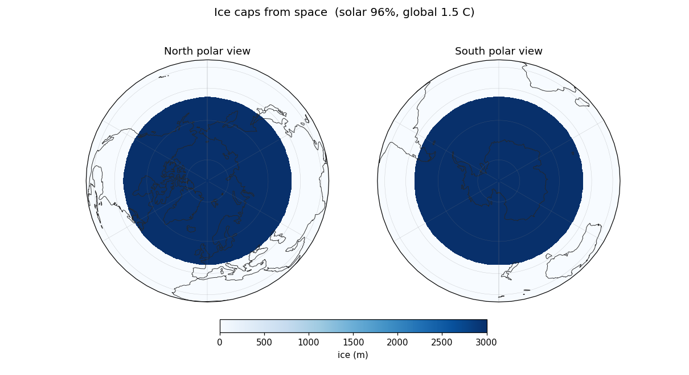
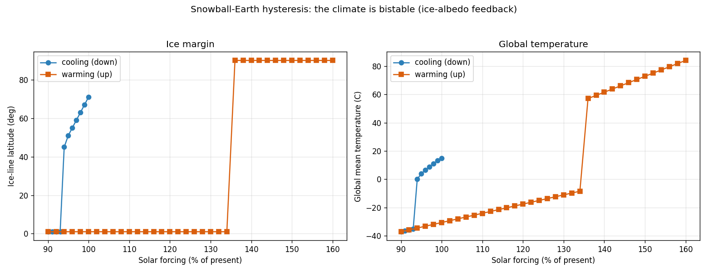

# Ice Age Simulator

**What happens to Earth if the Sun gets a little dimmer?**

This simulator answers that with real climate physics, and the answer is
surprising: dimming the Sun by just a few percent can freeze the entire planet,
and once it is frozen, it is extremely hard to thaw.



*Ice caps at 96% of today's sunlight, seen from above each pole. Coastlines are
drawn for orientation only; the model itself has no continents.*

## Earth has actually done this

- Between roughly **720 and 635 million years ago**, ice spread all the way to
  the equator, at least twice. Geologists call it **Snowball Earth**, a name
  coined by Joseph Kirschvink in 1992.
- Back in **1969**, Mikhail Budyko and William Sellers independently built
  simple climate models that predicted this kind of runaway freeze, long before
  the geological evidence for it was widely accepted.
- The Sun was dimmer back then: standard models of how the Sun brightens over
  time (Gough 1981) put it at about **94% of today's brightness**. That is
  right where this model tips over, although the leading explanations point
  to falling CO2 as the main trigger, with the fainter Sun leaving Earth
  closer to the edge.
- The real snowball ended because volcanoes kept pumping CO2 into the air.
  With the planet frozen, almost nothing removed it, so over millions of years
  the greenhouse effect grew strong enough to melt the ice.

This project is a modern, interactive version of those 1969 models.

## How it works, without equations

Earth's temperature is a balance between **sunlight coming in** and **heat
radiating back out to space**. The model splits the planet into a grid of
90 x 180 cells and finds, for each one, the temperature where those two
balance. Three ingredients make it interesting:

1. **Ice reflects sunlight.** In the model, ice reflects 60% of the sunlight
   that reaches it, compared with about 30% for an ice-free patch of planet.
   More ice means less sunlight absorbed, which means colder, which means more
   ice. It is a loop that feeds itself.
2. **CO2 follows temperature.** Cold oceans absorb more CO2 from the air. Less
   CO2 means a weaker greenhouse effect, which means colder, which means even
   less CO2. A second self-feeding loop. It has limits, though: seawater can't
   get colder than freezing, and once sea ice covers the ocean, no more CO2 can
   get in.
3. **Heat spreads around the globe.** Winds and ocean currents carry heat from
   the warm equator toward the cold poles. In the model, every place is pulled
   toward the global average, so cooling anywhere is felt everywhere.

Turn the Sun down a little and those loops amplify it into something much
bigger.

## What happens

Each row is the climate the model settles into for a given amount of sunlight:

| Sunlight | Average temperature | CO2 | Ice cover | Sea level (vs an ice-free Earth) |
| --- | --- | --- | --- | --- |
| 100% (today) | 15 C | 280 ppm | 6% | -68 m |
| 98% | 10 C | 231 ppm | 13% | -151 m |
| 96% | 1.5 C | 145 ppm | 28% | -315 m |
| **95%** | **-36 C** | **130 ppm** | **100%** | **-1124 m** |

The first row matches the real Earth: about 15 C on average, 280 ppm of CO2
before industrialization, and about 66 m of sea level locked up in the ice of
Antarctica and Greenland.

Now look at the last two rows. Going from 96% to 95% sunlight, the planet does
not get a little colder. It collapses from a cold world, with ice reaching the
mid-latitudes, into a frozen snowball. That sudden jump is a **tipping point**.


*The Sun dims at a steady rate (dashed line), but the climate does not respond
steadily: it slides gently, then falls off a cliff.*

## Freezing is easy, thawing is hard



This experiment dims the Sun until the planet freezes (blue), then brightens it
again (orange):

- Going down, the planet freezes over at **93%** of today's sunlight.
- Coming back up, it stays frozen until **136%**: it needs over a third *more*
  sunlight than today before the ice lets go.

Between those two values, both a warm planet and a frozen one are stable, and
which one you get depends on where the planet came from. Scientists call this
**hysteresis**. It is like a canoe: a small lean is enough to capsize it, but
rolling it back upright takes far more effort. A frozen planet reflects so much
sunlight that a brighter Sun barely helps, which is why the real Snowball Earth
needed a huge buildup of volcanic CO2 to escape.

*This experiment holds CO2 fixed to isolate the effect of the ice, which is why
it freezes at 93% rather than the 95% in the table above, where falling CO2
helps tip it sooner.*

## Watch it happen


## Try it yourself

The most fun way in is the live explorer: drag a slider to dim or brighten the
Sun and watch the ice respond in real time.

```bash
pip install .
python -m python_sim.interactive
```

Push the Sun down toward 94% and watch the ice run away. Then try to bring it
back: you can't. Even the slider's maximum of 115% won't thaw a snowball (see
why above). Press **Reset** to return to today's climate.

Even before a snowball, the ice is stubborn. Dip the Sun to 96% and back to
100%, and the planet stays several degrees colder than it started (about 9 C
once it fully settles): ice that has grown keeps itself cold by reflecting
sunlight. Real ice does this too, but less strongly than here (see the
limitations below).

(See [Install](#install) for compiler details.)

Every other experiment is a one-line command too; see [Run](#run).

## How realistic is it?

A few independent checks:

- **Today's Earth comes out right:** about 15 C on average, 280 ppm of CO2,
  and 66 m of sea level stored in ice.
- **Doubling CO2 warms it by 3.0 C.** The real-world best estimate is about
  3 C (likely range 2.5 to 4 C, IPCC 2021), and the model was never tuned to
  hit it.
- **Energy is conserved exactly:** once the climate settles, the sunlight
  absorbed equals the heat sent back to space.
- **The answers come from the physics, not the setup:** they don't change with
  the time step, and barely change with the grid size (within 0.2 C).
- **Automated tests** check these properties on Linux, Windows and macOS after
  every change.

## Honest limitations

A model this simple gets the big picture right but leaves a lot out:

- **No continents.** The grid has no map of land and sea, so climate only
  varies with latitude. Results form bands, not realistic geography.
- **Yearly averages.** There are no seasons and no day and night.
- **Ice is too stubborn.** Once ice grows, it keeps itself cold by reflecting
  sunlight, and here nothing breaks that loop: there are no summers to melt ice
  edges, and heat only flows to and from the global average rather than in
  from warm neighbouring regions. Real ice ages do end; in this model, a partly
  frozen world barely retreats when the Sun brightens again.
- **A simplified Sun.** The slider dims the whole Sun evenly. Real ice-age
  cycles (Milankovitch cycles) come from slow wobbles in Earth's orbit that
  shift *where and when* sunlight falls, with little change to the total.
- **Time is not in years.** The model shows where the climate settles, not
  how long the journey takes.
- **No volcanoes.** CO2 only moves between the air and the open ocean, so once
  the ocean freezes over it stays fixed. Unlike the real one, the model's
  snowball never builds up enough CO2 to thaw by itself.
- **Sea level is estimated.** It assumes the land share of any ice-covered
  area equals Earth's overall land fraction (29%).

---

## For developers

- **C++ core** (`include/`, `src/`): Struct-of-Arrays climate state (`float64`)
  stepped over discrete time iterations.
- **pybind11 bindings** (`bindings/`): expose the grid buffers to Python as
  **zero-copy** NumPy arrays (no copies between the engine and the plots).
- **Python layer** (`python_sim/`): run control, tunable parameters, and
  Matplotlib / Cartopy visualization.

### The model

The physics is a **Budyko-Sellers energy-balance model**. Each grid cell
relaxes toward the local equilibrium temperature:

```
solar_mult * (S0/4) * insol * (1 - albedo)      absorbed shortwave
    = olr_a + olr_b * T                          outgoing longwave (Budyko)
    + transport_c * (T - T_global)               meridional heat transport
    - co2_forcing * ln(CO2 / co2_base)           greenhouse forcing
```

The coefficients come from the literature: S0 = 1361 W/m2, olr_b = 2.09,
transport_c = 3.8, albedo 0.31 ice-free / 0.60 ice. The one tuned value is
olr_a = 200, lowered slightly from the commonly cited 203.3 so the baseline
lands on Earth's ~15 C.

The ice-albedo and CO2 feedbacks are built into the balance itself (albedo
enters the absorbed term, CO2 the greenhouse term) rather than bolted on as
gains. Heat transport is a coupling rather than a feedback: it links them by
spreading any local cooling planet-wide. CO2 is exchanged with the ocean only
through open water (the rate scales with `open_water_fraction`), and the ocean
temperature driving uptake is floored at freezing, so a frozen-over ocean
holds CO2 fixed. Ice is a state variable with memory: it forms below `t_freeze`
and melts only when the iced cell itself rises above it, which is what makes
partial glaciations sticky. The external driver is the solar
multiplier, a uniform brightening or dimming of the Sun. Time advances in
abstract model steps, not years. Every coefficient lives in the `Params` struct
and is settable from Python.

### Install

Prereqs: a C++17 compiler (MinGW GCC or MSVC), CMake 3.18+, Python 3.9+. The
C++ extension builds automatically; scikit-build-core drives CMake.

```bash
pip install .
```

For an editable/development install (Python edits take effect immediately;
re-run it after changing the C++ sources):

```bash
pip install -e .
```

On Windows with MinGW, force the Ninja generator so CMake uses GCC rather than
looking for MSVC (PowerShell shown; use `set CMAKE_GENERATOR=Ninja` in cmd, or
`export` in bash):

```bash
$env:CMAKE_GENERATOR="Ninja"
pip install .
```

### Build from source (development)

To build the extension in place without installing (so `import python_sim`
works from the repo root):

```bash
python -m pip install -r requirements.txt
cmake -S . -B build -G Ninja
cmake --build build --config Release
```

pybind11 is discovered automatically from the active Python. The extension is
emitted into `python_sim/` as `_core*.pyd`; on MinGW the C++ runtime is
statically linked (handled in `CMakeLists.txt`), so the module is
self-contained.

### Run

All scripts run from the repo root once the extension is built.

| Command | What it does |
| --- | --- |
| `python -m python_sim.interactive` | Live window: drag the solar slider and watch the climate respond. Needs an interactive Matplotlib backend. |
| `python -m python_sim.main` | Prints the present-day climate next to real-Earth values, then dims the Sun step by step to the snowball. |
| `python -m python_sim.tipping` | The hysteresis experiment: sweeps sunlight down and back up and plots the loop. |
| `python -m python_sim.timeseries` | Slowly dims the Sun and plots temperature, CO2, sea level and ice cover over time. |
| `python -m python_sim.visualizer` | Flat latitude/longitude snapshot (temperature, ice, albedo). Matplotlib only, no network. |
| `python -m python_sim.geomap` | Snapshot on a Cartopy globe (Robinson projection) with coastlines. |
| `python -m python_sim.polar` | The ice caps seen from above each pole. |
| `python -m python_sim.animate` | GIF of a full run on flat maps. |
| `python -m python_sim.animate_globe` | GIF of a full run on the Cartopy globe. |
| `python -m python_sim.animate_polar` | GIF of the polar ice caps spreading. |
| `python docs/make_images.py` | Regenerates the README images in `docs/images/`. |

The Cartopy scripts download Natural Earth coastline data on first run (needs a
network connection), then cache it. Generated figures land in `figures/`, which
is git-ignored.

### Tests

A `pytest` suite in `tests/` locks in the physics: zero-copy bindings, the
realistic present-day baseline (~15 C), the analytic energy balance, the
sea-level formula and its physical bounds, CO2's physical limits, runs starting
from today's settled climate, and the snowball tipping behaviour.
Build the extension first, then:

```bash
python -m pytest tests/ -v
```

CI runs the suite on Linux, Windows and macOS on every push.

### Layout

```
include/      simulation_params.hpp, simulation_engine.hpp, climate_grid.hpp
src/          simulation_engine.cpp, climate_grid.cpp
bindings/     pybind_wrapper.cpp   (zero-copy NumPy views)
python_sim/   the Python package: interactive, main, tipping, timeseries,
              visualizer, geomap, polar, animate, animate_globe, animate_polar
tests/        pytest suite
docs/         make_images.py and the README images
.github/      CI: build and test on Linux, Windows and macOS
CMakeLists.txt, pyproject.toml, requirements.txt
```
